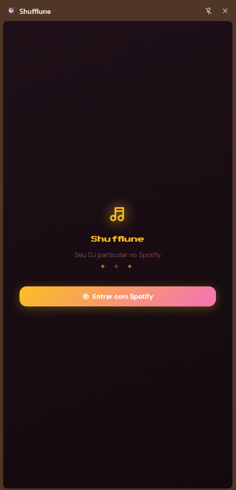
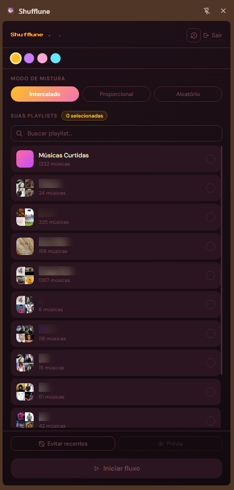
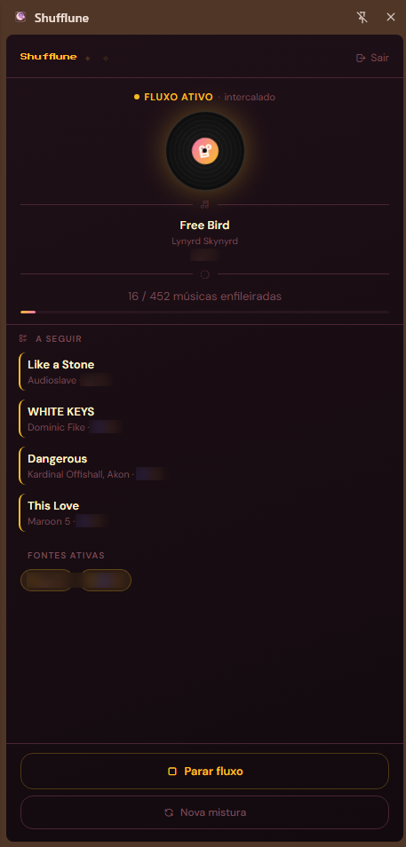

# Shufflune

Extensão do Chrome (Manifest V3) que intercala várias playlists do Spotify em uma única fila de reprodução. Pensada para quem tem playlists separadas por humor ou gênero e quer ouvi-las misturadas, sem montar uma playlist nova.

## Funcionalidades

- Login com Spotify via OAuth 2.0 PKCE, sem backend.
- Seleção de duas ou mais playlists próprias ou colaborativas, mais "Músicas Curtidas", com busca por nome.
- Três modos de mistura:
  - **Intercalado:** alterna entre playlists em blocos de 1 a 3 músicas.
  - **Proporcional:** cada playlist tem peso de 1 a 10, e peso maior significa mais aparições.
  - **Aleatório:** pool único embaralhado, sem mais de 3 músicas seguidas da mesma playlist.
- Ordem por playlist: original ou embaralhada (Fisher-Yates).
- Filtro opcional que remove músicas tocadas recentemente (últimas 50 do Spotify).
- Preview das primeiras 12 músicas antes de iniciar.
- Histórico das 10 últimas misturas, com opção de repetir.
- Painel lateral (side panel) com música atual, próximas músicas, progresso e playlists ativas.
- 4 temas visuais (Rose Gold, Midnight, Sakura, Aurora), salvos no navegador.

## Tecnologias

- JavaScript (sem framework e sem build), HTML e CSS
- Chrome Extensions API (Manifest V3): service worker, `identity`, `storage`, `alarms`, `sidePanel`
- Spotify Web API
- OAuth 2.0 com PKCE (S256)
- Sem backend: tokens e estado ficam em `chrome.storage.local`

## Como funciona

| Arquivo | Responsabilidade |
|---|---|
| `manifest.json` | Permissões, service worker e side panel |
| `background.js` | Autenticação, chamadas à API, algoritmos de mistura, motor do DJ, histórico |
| `popup.html` / `popup.js` / `popup.css` | Interface do side panel (login, seleção, reprodução, temas) |
| `shufflune-docs.md` | Documentação técnica detalhada |

**Autenticação.** `background.js` gera um `code_verifier` e o `code_challenge` (SHA-256), abre `chrome.identity.launchWebAuthFlow` em `accounts.spotify.com/authorize` com `redirect_uri = chrome.identity.getRedirectURL()`, troca o `code` por tokens em `/api/token` e salva `access_token`, `refresh_token` e `expires_at`. O token é renovado automaticamente com 60 s de antecedência; se o refresh falha, os tokens são apagados e o login é pedido de novo.

**Mistura.** O popup envia as playlists escolhidas ao service worker, que baixa as faixas (paginação de 50) e monta a fila completa conforme o modo. No modo Intercalado, a ordem das playlists é sorteada a cada rodada e cada visita consome um bloco de 1 a 3 faixas. No Proporcional, cada rodada sorteia uma janela com `max(1, round(peso × 3))` posições por playlist. No Aleatório, o pool é embaralhado e, quando há 3 faixas seguidas da mesma playlist, a próxima é trocada por uma de outra playlist dentro das 50 posições seguintes.

**Reprodução.** Antes de tocar, a extensão lista os dispositivos (`GET /me/player/devices`); se não houver nenhum, abre `open.spotify.com` numa aba e aguarda até 15 s. Se o dispositivo escolhido não estiver ativo, a reprodução é transferida para ele. A primeira faixa é tocada com `PUT /me/player/play` e as seguintes entram com `/me/player/queue`, mantendo um buffer de 15 faixas. Um alarme (`djMonitor`, a cada 30 s) consulta o estado do player e reabastece a fila.

## Como rodar

1. Em [developer.spotify.com/dashboard](https://developer.spotify.com/dashboard), crie um app e marque **Web API**.
2. Copie `config.example.js` para `config.js` e coloque o seu `CLIENT_ID`. O `config.js` é ignorado pelo git.
3. Abra `chrome://extensions`, ative **Modo do desenvolvedor** e clique em **Carregar sem compactação**, escolhendo a pasta do projeto.
4. O manifest tem o campo `key`, então o ID da extensão é fixo: `gjadkjiomljlmmodgfpbeokmikecplkb`.
5. No app do Spotify, em **Edit Settings > Redirect URIs**, cadastre exatamente (a barra final é necessária):
   ```
   https://gjadkjiomljlmmodgfpbeokmikecplkb.chromiumapp.org/
   ```
   Para conferir, rode `chrome.identity.getRedirectURL()` no console do service worker.
6. Em **User Management**, adicione o e-mail da conta Spotify que vai usar a extensão.
7. Clique no ícone da extensão para abrir o painel lateral e faça login.

> Se você fizer fork e trocar a `key` do manifest, o ID muda e o Redirect URI precisa ser atualizado. A chave privada (`*.pem`) não é versionada.

## Limitações

- Regras do Spotify para apps em modo de desenvolvimento (documentação oficial, fev/2026): até 5 usuários autorizados por Client ID, cadastrados em User Management, e o dono do app precisa ter Spotify Premium. Apps criados antes da mudança podem ter regras diferentes; confira a [documentação atual](https://developer.spotify.com/documentation/web-api/concepts/quota-modes).
- Só lê faixas de playlists próprias ou colaborativas; as demais retornam 403 e são ignoradas.
- A documentação do endpoint de reprodução (`PUT /me/player/play`) informa que ele só funciona para contas Premium. O código não verifica isso.
- Precisa de um dispositivo Spotify para tocar. Sem nenhum, a extensão abre o web player, mas pode ser necessário entrar na conta e apertar play nele uma vez.
- Requer Chrome com suporte a Side Panel (114+, segundo o `shufflune-docs.md`).
- Faixas locais são ignoradas.

## Demonstração

| Login | Seleção de playlists | Fluxo ativo |
|---|---|---|
|  |  |  |

Nomes das playlists desfocados.

## Minha parte

Projeto pessoal, projetado e desenvolvido por mim, Ana Letícia de Souza Pinheiro.
